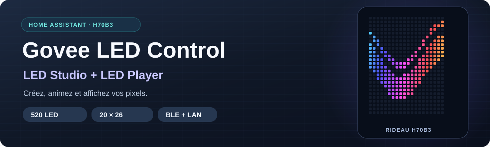
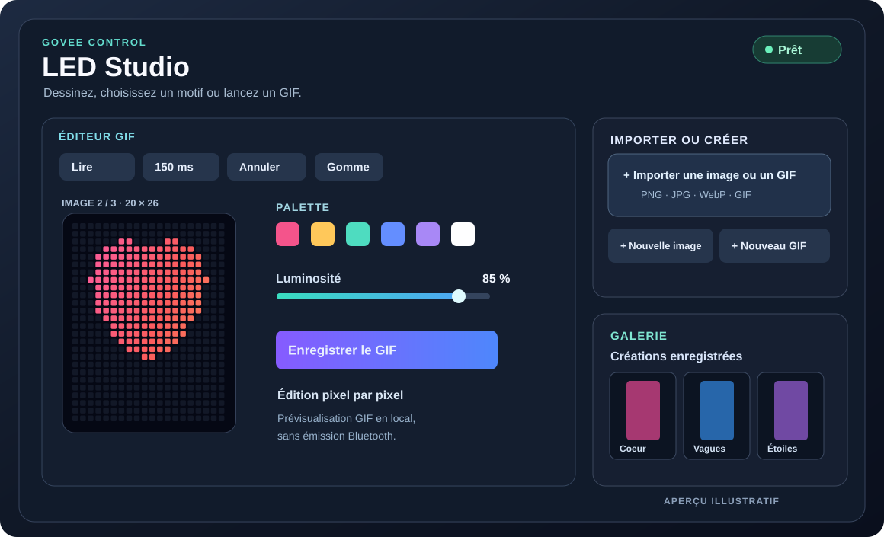
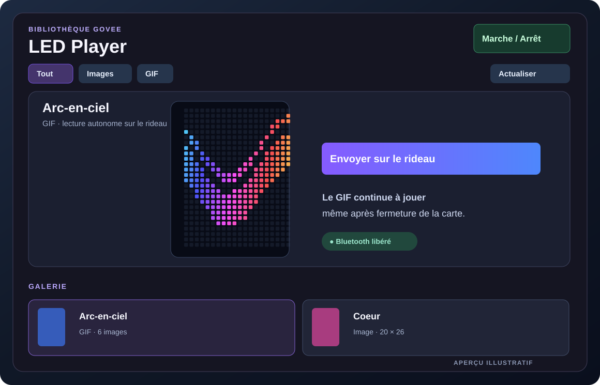

<p align="center">
  <a href="https://github.com/jackmc2/govee-led-control-haos/releases/latest"></a>
  <a href="https://github.com/jackmc2/govee-led-control-haos/actions/workflows/validate.yml"></a>
  <a href="LICENSE"></a>
  <a href="https://www.home-assistant.io/"></a>
</p>

<p align="center">
  <strong>Un atelier de création et une galerie pour votre rideau LED Govee H70B3.</strong><br>
  Créez vos images, animez vos GIF, puis envoyez-les sur le rideau depuis Home Assistant — en local.
</p>

<p align="center">
  <a href="#-installation">Installation</a> ·
  <a href="#-led-studio">LED Studio</a> ·
  <a href="#-led-player">LED Player</a> ·
  <a href="#-configuration-des-cartes">Cartes Lovelace</a> ·
  <a href="#-documentation">Documentation</a>
</p>

---

## ✨ En bref

| **20 × 26** | **520 LED** | **Bluetooth + LAN** | **GIF autonomes** |
| :---: | :---: | :---: | :---: |
| Matrice du H70B3 | Contrôle pixel par pixel | Transfert BLE, marche/arrêt LAN | Le rideau continue de jouer sans streaming HA |

- 🎨 **Créer** une image ou un GIF directement depuis le tableau de bord Home Assistant.
- 🖼️ **Importer** des fichiers PNG, JPEG, WebP, BMP ou GIF et les adapter à la matrice.
- 🧩 **Modifier** les pixels, les couleurs et les images d'une animation dans un éditeur commun.
- 📁 **Enregistrer** et retrouver les créations dans une galerie persistante Home Assistant.
- ▶️ **Prévisualiser** les GIF dans le navigateur avant de les envoyer.
- 📡 **Transférer** une image ou un GIF natif en Bluetooth, puis libérer la connexion.
- ⏻ **Allumer ou éteindre** le H70B3 directement en LAN, sans service cloud supplémentaire.

> **Matériel :** le H70B3 est le modèle principal, avec transferts d'images et de GIF validés sur l'appareil. Le code des panneaux **H6069** reste présent pour sa compatibilité LAN ; l'éditeur graphique illustré ici est dédié au H70B3.

## 🎨 LED Studio



**L'espace de création**, intégré à une carte Lovelace :

- Créez une nouvelle image ou une animation, ou importez un fichier existant.
- Dessinez sur la matrice **20 × 26**, choisissez vos couleurs et ajustez la luminosité.
- Pour un GIF, parcourez les images, changez leur durée et lancez la **lecture locale** dans l'éditeur.
- Enregistrez votre création dans la galerie, où elle restera modifiable.

L'éditeur n'occupe pas l'écran au démarrage : il s'ouvre quand vous importez, créez ou modifiez une création.

## ▶️ LED Player



**La carte de lecture**, pensée pour un usage quotidien :

- Parcourez la galerie avec les filtres **Tout / Images / GIF**.
- Prévisualisez une création et cliquez sur **« Envoyer sur le rideau »**.
- Retrouvez votre galerie en **deux colonnes, sous la prévisualisation**.
- Utilisez le bouton **Marche / Arrêt** via le réseau local.

Pour les GIF natifs H70B3, le fichier est transféré en une opération Bluetooth : **le rideau poursuit la lecture après fermeture de la carte ou du navigateur**. L'application Govee Home peut reprendre le contrôle et changer l'effet.

<sub>Les deux visuels ci-dessus sont des **illustrations de l'interface**, pas des captures d'écran du matériel. Ils représentent les commandes présentes dans les cartes.</sub>

## 🚀 Installation

### Home Assistant Marketplace (recommandé)

L'intégration est disponible depuis le **[dépôt public GitHub](https://github.com/jackmc2/govee-led-control-haos)** et sa [dernière release](https://github.com/jackmc2/govee-led-control-haos/releases/latest).

1. Dans **Home Assistant 2026.11 ou version ultérieure**, ouvrez **Paramètres → Marketplace → Ajouter depuis un lien**.
2. Collez l'adresse du dépôt :

   ```text
   https://github.com/jackmc2/govee-led-control-haos
   ```

3. Sélectionnez le type **Intégration**, installez la version proposée et **redémarrez Home Assistant**.
4. Dans **Paramètres → Appareils et services → Ajouter une intégration**, recherchez **Govee LED Control — HAOS** et configurez votre appareil si ce n'est pas déjà fait.
5. Ajoutez ensuite les cartes LED Studio et LED Player à votre tableau de bord.

**Les deux cartes frontend sont livrées dans l'intégration** : aucun dépôt de cartes supplémentaire n'est nécessaire.

> **Migration depuis un ancien fork :** si le Marketplace indique que le dossier `govee_led_control` appartient déjà à un autre dépôt, **n'installez pas par-dessus et ne supprimez pas votre appareil depuis Appareils et services**. Sauvegardez Home Assistant et vérifiez d'abord la propriété de l'installation dans Marketplace. La configuration de l'appareil et la galerie ne doivent pas être effacées.

### Installation manuelle

Copiez `custom_components/govee_led_control/` vers `/config/custom_components/govee_led_control/`, puis redémarrez Home Assistant. L'installation depuis le Marketplace est préférable pour recevoir les mises à jour.

## 🧱 Configuration des cartes

### LED Studio

```yaml
type: custom:govee-led-studio
h70b3_transport_entity: sensor.h70b3_transport
```

Adaptez l'identifiant de l'entité de transport à votre installation si nécessaire.

### LED Player

```yaml
type: custom:govee-led-player
title: LED Player
```

Si le H70B3 n'est pas découvert automatiquement sur votre réseau, vous pouvez préciser son **adresse IP locale** :

```yaml
type: custom:govee-led-player
title: LED Player
lan_ip: 192.168.1.50
```

`192.168.1.50` est une **adresse d'exemple**. Elle ne correspond pas à un appareil réel imposé par le projet.

Après une mise à jour des fichiers JavaScript, un rechargement forcé du navigateur (`Ctrl + F5`) peut être nécessaire.

## 🔌 Fonctionnement

```text
                 Home Assistant OS
                         │
               Govee LED Control
                  /           \
           LED Studio       LED Player
         Création/édition   Galerie/lecture
                  \           /
                   Galerie locale
                         │
                 ┌───────┴──────┐
                 │              │
             Bluetooth         LAN
          Images / GIF      Marche / arrêt
                 │              │
                 └───────┬──────┘
                         │
                 Govee H70B3
                   20 × 26 LED
```

Le H70B3 doit être accessible via un **adaptateur Bluetooth Home Assistant** ou un **proxy Bluetooth ESPHome** capable d'établir une connexion. La configuration manuelle accepte l'adresse **MAC Bluetooth**, différente de l'IP Wi-Fi.

Le transfert Bluetooth des images et des GIF est ponctuel ; la commande Marche / Arrêt utilise le réseau local. Les usages décrits ne nécessitent pas le cloud Govee.

## 🧪 Validation

Les [GitHub Actions](https://github.com/jackmc2/govee-led-control-haos/actions/workflows/validate.yml) exécutent les vérifications **HACS**, **Hassfest** et les tests de protocole et d'interface.

```bash
python -m unittest discover -s tests -v
node --check custom_components/govee_led_control/frontend/govee-led-studio.js
node --check custom_components/govee_led_control/frontend/govee-led-player.js
node tests/test_studio_editor.mjs
node tests/test_led_player.mjs
```

## 📚 Documentation

- [LED Player : commandes, galerie et contrôle LAN](docs/LED_PLAYER.md)
- [Connexion Bluetooth et diagnostic H70B3](docs/BLUETOOTH_CONNECTION.md)
- [Transfert GIF natif H70B3](docs/NATIVE_GIF_EXPERIMENT.md)
- [Entités et identifiants Home Assistant](docs/ENTITY_IDS.md)
- [Versions publiées](https://github.com/jackmc2/govee-led-control-haos/releases)

## 🤝 Licence

Projet communautaire **non officiel**, sans affiliation avec Govee ou Home Assistant. Distribué selon les termes de la [licence MIT](LICENSE), avec conservation des mentions de copyright applicables.
